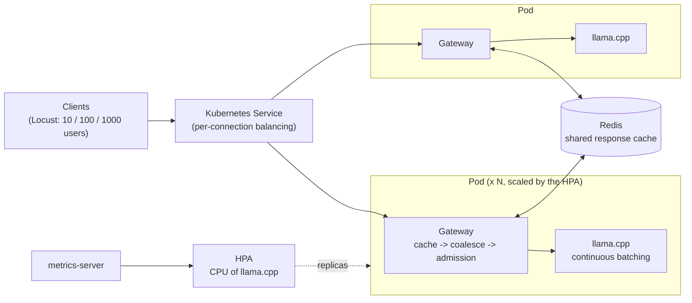
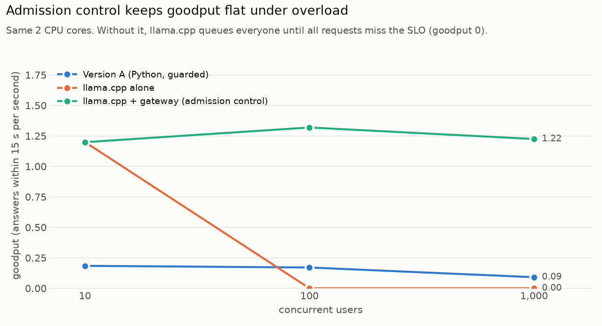
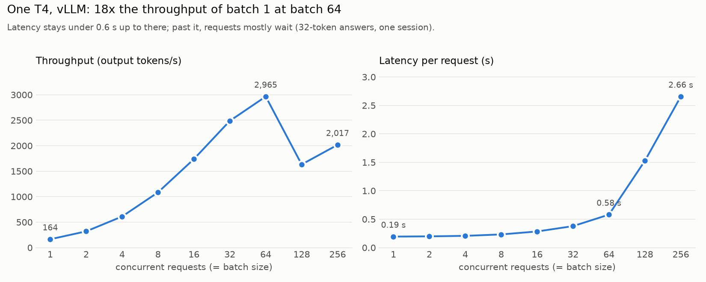
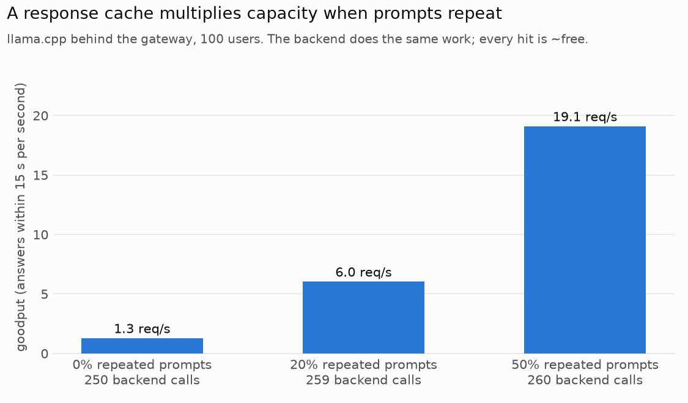
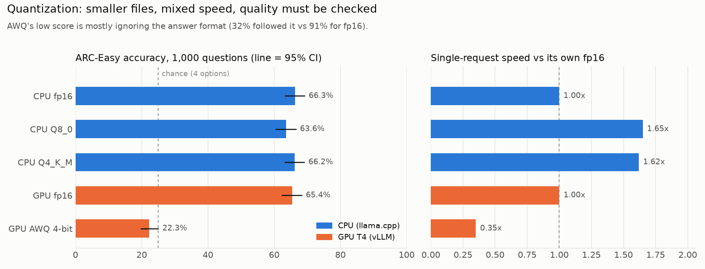
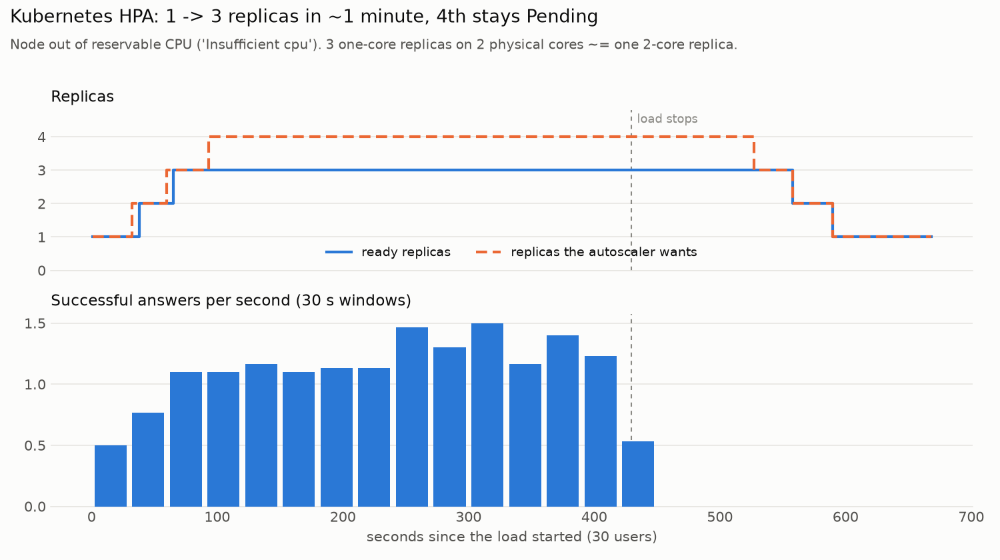
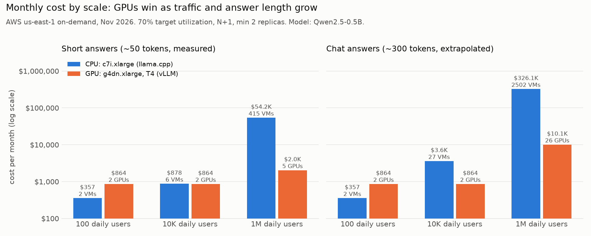

# LLM serving at scale

Serving one small LLM ([Qwen2.5-0.5B-Instruct](https://huggingface.co/Qwen/Qwen2.5-0.5B-Instruct)) five
different ways, load-testing every one with the same harness, and turning the measurements into a
capacity plan for **100 / 10K / 1M daily users**.

Built on a laptop that couldn't run any of it: CPU work in a 4-core GitHub Codespace, GPU work on a
free Kaggle T4. Every number below was measured unless it says otherwise.

## Results in one table

| What | Measured | Why it matters |
|---|---|---|
| **Admission control** in front of llama.cpp | goodput at 100 / 1000 users: **0 → 1.32 / 1.22 req/s** | Without a bounded queue, overload makes *every* request miss the SLO |
| **Continuous batching** (vLLM, one T4) | **18x** batch-1 throughput at batch 64; **124-144 req/s** at 1000 users, p95 < 7 s | One GPU replaces ~100 CPU replicas |
| **Static micro-batching** (Python server, CPU) | ~**1x** throughput, **5x** latency | Batching only pays when compute is free to share (GPU), not on a compute-bound CPU |
| **Response cache** (Redis), 100 users | goodput **1.3 → 6.0 → 19.1 req/s** at 0 / 20 / 50% repeated prompts | Backend work stays constant (~260 calls); hits are ~free |
| **Quantization**, CPU (llama.cpp) | Q4_K_M: same accuracy, **1.6x** single-stream speed, **0.84x** capacity | Smaller ≠ faster under load once compute-bound |
| **Quantization**, GPU (vLLM AWQ on T4) | **0.35x** speed; followed the answer format **32%** of the time (fp16: 91%) | Quantization can break instruction-following before knowledge |
| **Kubernetes rolling restart** under load | **0 / 133** errors (Docker Compose restart: 35 errors over 31 s) | Readiness probes + surge + preStop drain |
| **Autoscaling (HPA)** | 1 → 3 replicas in ~60 s; 4th **Pending** (`Insufficient cpu`) | The HPA adds pods, not machines |
| **Capacity plan**, 1M daily users | **5 T4s, ~$2.0K/month** (50-token answers); **26 T4s, ~$10.1K/month** (300-token chat) | Answer length moves cost as much as user count |

## Architecture



**One pod = one model server + its own gateway (sidecar)**, so each replica brings its own admission
limit and capacity and admission scale together. The gateway is backend-agnostic: the same code fronts
Version A, llama.cpp and vLLM (`compose.vllm.yaml`).

**Request path through the gateway:**
1. **Cache:** deterministic requests (temperature 0) are answered from Redis by SHA-256 of the request.
   Redis down → cache bypassed for 5 s (circuit breaker), never an outage.
2. **Coalescing:** identical requests already running wait for that one result (10 → 1 backend call).
3. **Admission control:** at most `MAX_INFLIGHT` (= backend slots) in flight, a bounded queue with a
   deadline, everything else gets a fast `503 + Retry-After`.
4. **Backend:** an unreachable backend is a `503 + Retry-After`, not a 502.

## The five ways to serve it

| Version | Engine | Where | Key idea |
|---|---|---|---|
| A | FastAPI + transformers | CPU | The naive baseline: one request at a time |
| A + gateway | + static micro-batching | CPU | Batch several requests per `generate()` call |
| B1 | llama.cpp (`--cont-batching`) | CPU | C++ kernels + continuous batching, 8 slots |
| B2 | vLLM (PagedAttention) | Kaggle T4 | Continuous batching on a GPU, KV cache in pages |
| C | llama.cpp Q8_0 / Q4_K_M, vLLM AWQ | both | Quantization: quality vs. speed |

## Charts

| | |
|---|---|
|  |  |
|  |  |
|  |  |

Regenerate with `python scripts/make_charts.py`.

## What I learned (the non-obvious parts)

1. **Throughput is the wrong metric under overload; goodput is the right one.** llama.cpp's throughput at
   1000 users was still 0.63 req/s, but every answer took ~56 s, so goodput was 0. Little's Law
   predicts it: an unbounded queue turns extra users into extra waiting, not extra work.
2. **Batching is a GPU superpower and a CPU non-event.** Decode is memory-bandwidth-bound at batch 1, so a
   GPU serves 64 sequences for little more than the cost of one. The 2-core CPU is compute-bound by batch
   ~3 (roofline), so static batching in Python only added head-of-line blocking.
3. **Measuring quality is harder than measuring speed.** The first GPU quality run was invalid: vLLM
   silently applied the model's `generation_config.json` (repetition penalty 1.1, which penalises the
   option letters in the prompt), and a lenient answer parser "found" answers in step-by-step replies
   (AWQ "chose" A 73% of the time). Fixes: pinned decoding (`--generation-config vllm`), a strict parser,
   paired McNemar tests on the same 1,000 questions.
4. **Quantization isn't automatically faster.** On a compute-bound CPU, Q4's dequantization cost erased its
   bandwidth win under load (0.84x capacity). On the T4 without a fast AWQ kernel (Marlin needs a newer
   GPU), 4-bit was 2.9x *slower* per request.
5. **Zero-downtime needs four things together:** ≥2 replicas, `maxUnavailable: 0`, readiness probes,
   and a `preStop` pause so in-flight requests drain before SIGTERM.
6. **Kubernetes Services balance connections, not requests.** Keep-alive clients stick to one pod, so new
   replicas get no traffic. Here the gateway sends `Connection: close`; in production an L7 balancer does it.
7. **Scaling out on one machine adds no hardware.** 3 one-core replicas on a 2-physical-core box served
   the same 1.2 req/s as one 2-core replica, with worse latency.

## What could not be tested here (and what I'd do with real hardware)

- **Multi-node Kubernetes, the Cluster Autoscaler, cloud load balancers, multi-zone failover.** kind is one
  node, so the 4th replica could only stay Pending.
- **vLLM behind the gateway and inside Kubernetes**, and **GPU autoscaling** on queue length / KV-cache usage
  (custom metrics) instead of CPU. Kaggle has no Docker or Kubernetes.
- **Larger models (7-8B) and other GPUs** (L4, A10G, H100 with Marlin/FP8 kernels). Every capacity number
  is for a 0.5B model; the method transfers, the numbers must be re-measured.
- **Streaming (time-to-first-token)**, prefix caching with real system prompts, long-context workloads.
- **Open questions left open:** why Q8_0 lost 2.7 points on CPU while Q4_K_M didn't; whether AWQ's
  format-following drop is the method or the T4's fallback kernel; why a `curl` healthcheck saw HTTP 503
  where a raw-socket check saw 200; why llama.cpp waited for the 30 s grace period on SIGTERM.

## Reproduce

Codespaces (4-core) for everything CPU, Kaggle (GPU T4 x2, Internet on) for the GPU notebooks.

| Step | What | Command |
|---|---|---|
| 1-2 | Environment, model, KV-cache demo | `python scripts/check_env.py` · `python scripts/download_model.py` · `python scripts/smoke_test.py` |
| 3-4 | Version A + load tests | `bash scripts/run_version_a_probes.sh` · `bash scripts/run_version_a_load.sh` |
| 5 | llama.cpp (CPU) | `python scripts/download_gguf.py fp16` · `bash scripts/run_llamacpp_load.sh` |
| 6 | vLLM (GPU) | Kaggle: `kaggle/step6_vllm_t4.ipynb` |
| 7 | Quantization | `bash scripts/run_quant_cpu.sh` · Kaggle: `kaggle/step7b_awq_t4.ipynb` |
| 8 | Gateway: admission, cache, micro-batching | `python tests/test_gateway.py` · `bash scripts/run_gateway_experiments.sh` |
| 9 | Docker Compose + failure drills | `bash scripts/run_compose_checks.sh` |
| 10 | Kubernetes (kind) + HPA | `bash scripts/setup_kind.sh` · `bash scripts/run_k8s_checks.sh` |
| 11 | Capacity plan | `python capacity/plan.py` → [`docs/CAPACITY_PLAN.md`](docs/CAPACITY_PLAN.md) |
| 12 | Charts | `python scripts/make_charts.py` |

Load-test method (same for every version): Locust `FastHttpUser`, 30 prompts in three length classes,
1-3 s think time, 180 s runs with the first 30 s excluded, **goodput = answers within a 15 s SLO**.
Quality: 1,000 ARC-Easy questions (seed 0), greedy decoding, strict answer parsing, paired McNemar test.

## Repository layout

```
serving/naive_hf/      Version A: FastAPI + transformers (+ admission control, + batch endpoint)
serving/llamacpp/      llama.cpp server launcher (Docker)
serving/gateway/       the gateway: cache, coalescing, admission control, micro-batching (+ Dockerfile)
loadtest/              Locust harness, summarizer
eval/                  ARC-Easy quality eval, strict parser, paired comparison, rescoring
kaggle/                GPU notebooks (vLLM sweep + load test, AWQ vs fp16)
compose.yaml           CPU stack: gateway + Redis + llama.cpp      compose.vllm.yaml: GPU variant
deploy/k8s/            kind cluster, Deployments, Services, HPA
capacity/              capacity-plan calculator + assumptions
scripts/               experiment runners, drills, charts
tests/                 gateway test suite (20 checks, fake backends + fakeredis)
results/               every measurement (CSV), raw logs, charts
docs/                  CAPACITY_PLAN.md
```

## Further reading in this repo
- [`docs/CAPACITY_PLAN.md`](docs/CAPACITY_PLAN.md): replicas, GPUs and monthly cost per tier, bottlenecks, caveats
